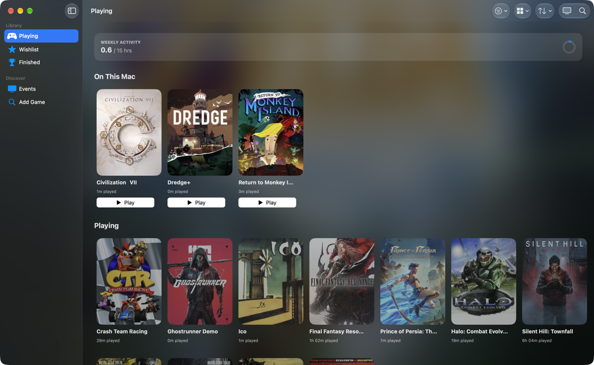
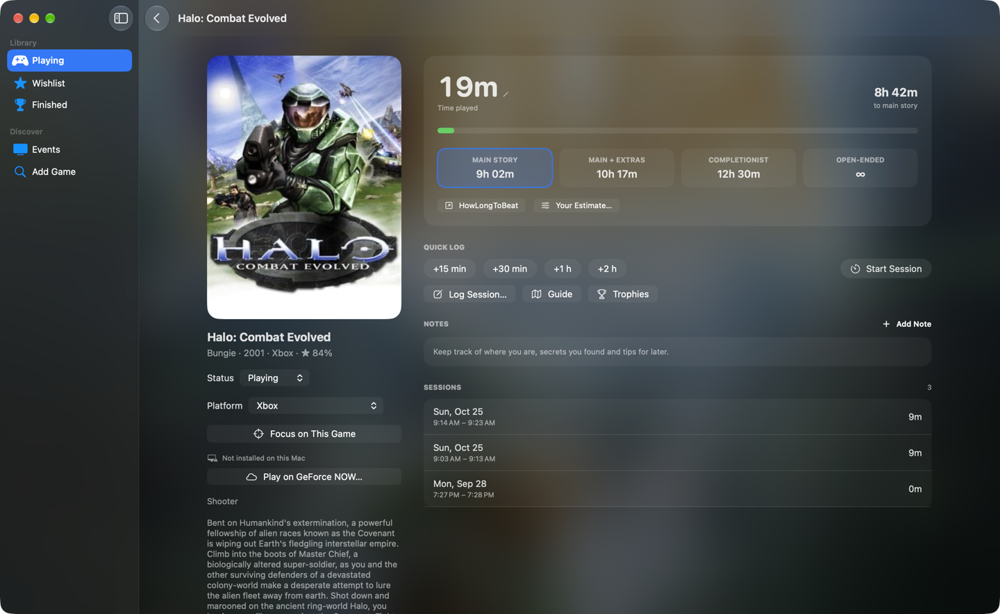
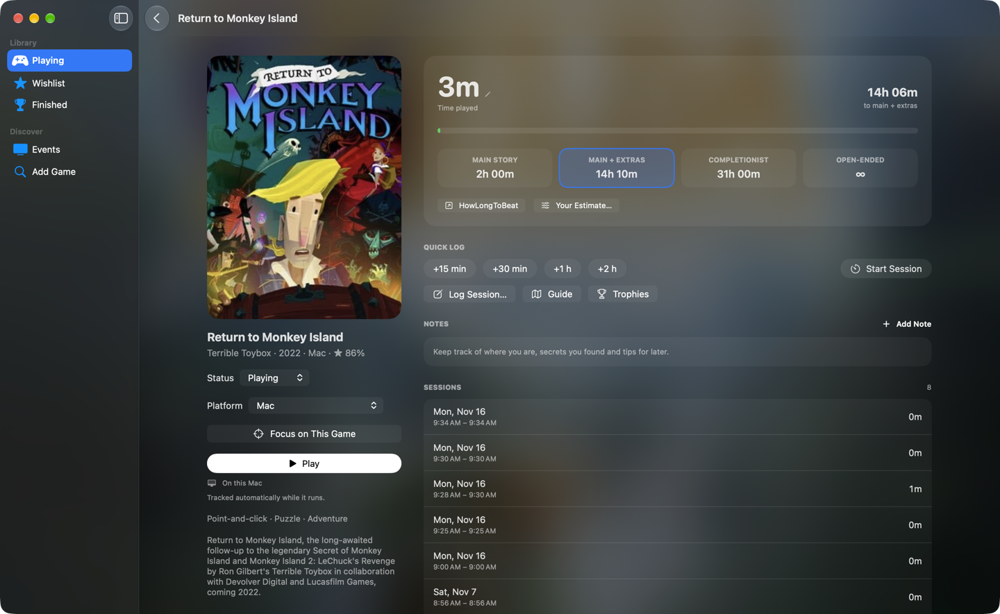
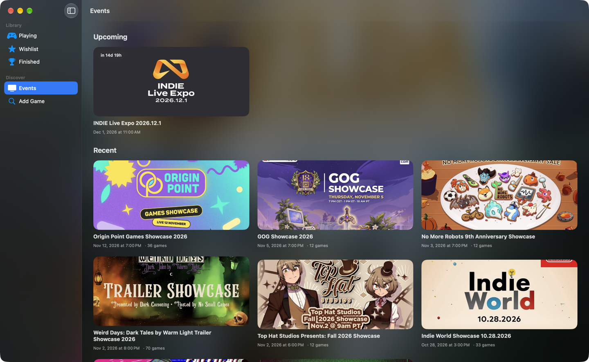
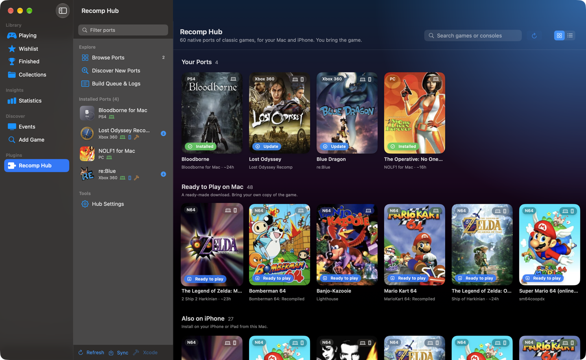
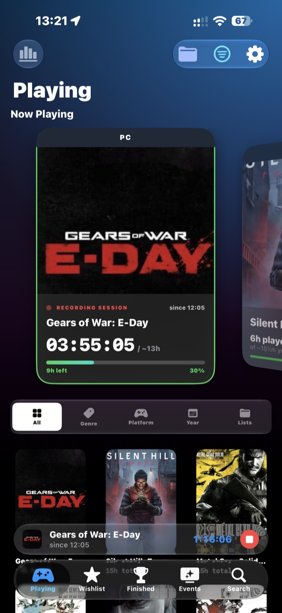
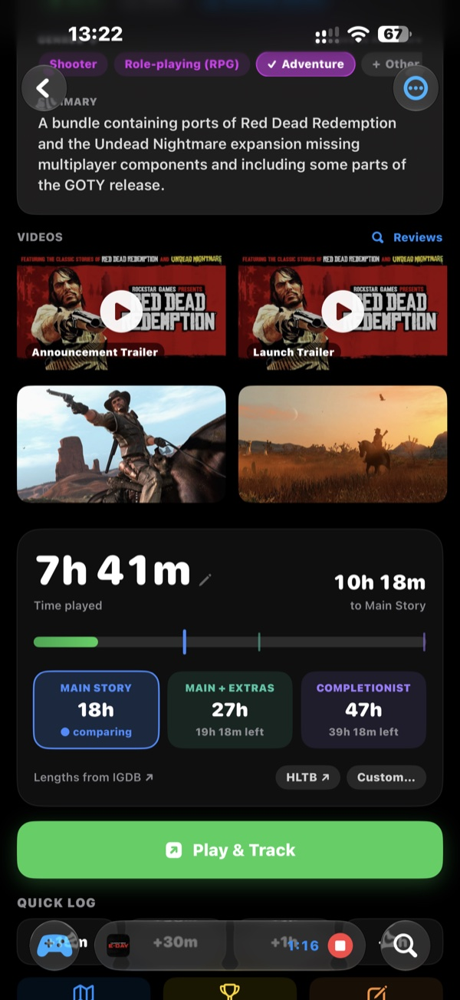
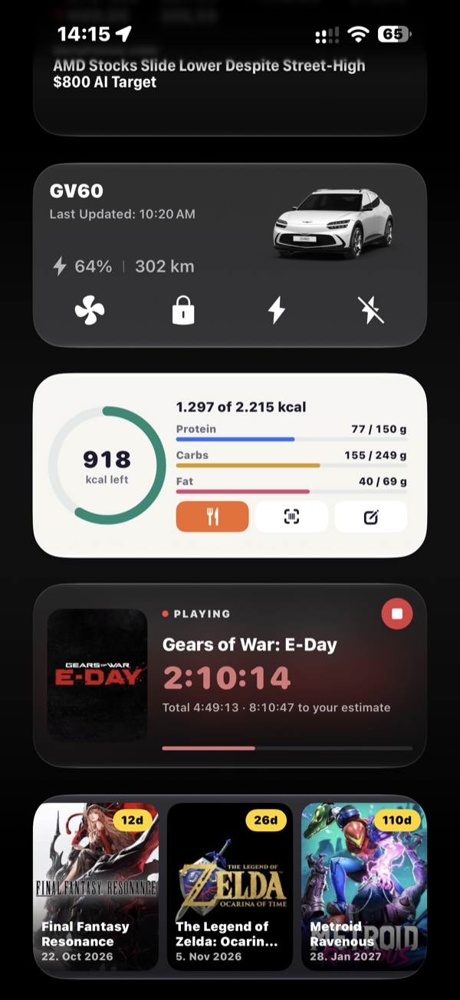
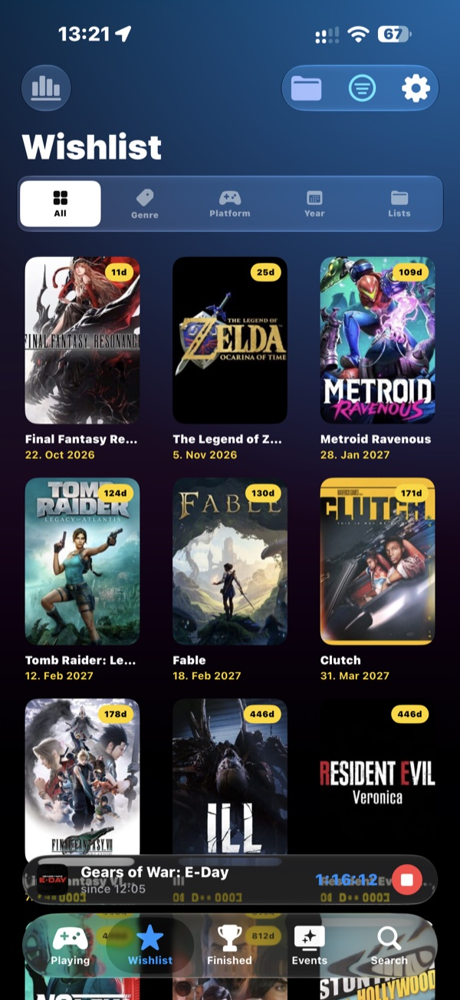
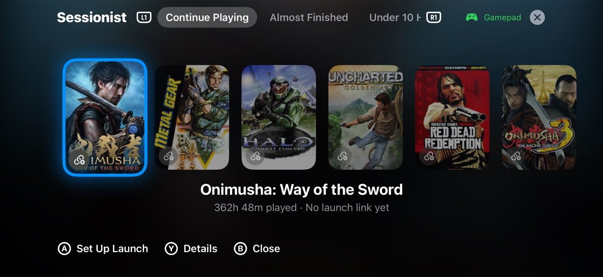

# Sessionist: Game Tracker

Track how long you play — on iPhone, iPad, and Mac.

- **macOS (Direct Edition + Recomp Hub):** [Download latest DMG](https://github.com/n-elnouby/SessionistApp/releases/latest) *(macOS 14+, Universal, Notarized)*
- **iOS & iPadOS:** [Download on the App Store](https://apps.apple.com/app/id6758464286)
- **Website & Support:** https://n-elnouby.github.io/SessionistApp/

## iCloud Sync between Mac and iPhone

The Mac version from GitHub and the iOS app from the App Store share one library: games, sessions, collections, wishlist, notes and the running timer.

There is no account and nothing to sign in to. Sessionist uses the Apple ID you're already signed in with:

1. Use the **same Apple ID** on your Mac and iPhone, with iCloud turned on.
2. Open Sessionist on both. The first sync can take a minute or two.

Not syncing? Check that Sessionist may use iCloud: on iPhone, **Settings → [your name] → iCloud → Apps Using iCloud**; on Mac, **System Settings → [your name] → iCloud → Saved to iCloud → See All**. The Mac app's **Settings → Sync Status** shows the last sync and has a **Repair** button if two devices show different libraries.

## Screenshots

### Mac

  
  
  
  

**Recomp Hub** (Direct edition): native ports of classic games for Mac and iPhone, with cover art and one-click installs. You bring your own copy of the game.

  

### iPhone

  
  
  
  

Turn the iPhone sideways for the **launcher**, made for playing with a controller:

  

